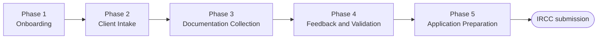
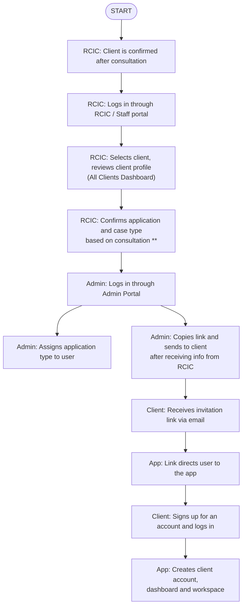
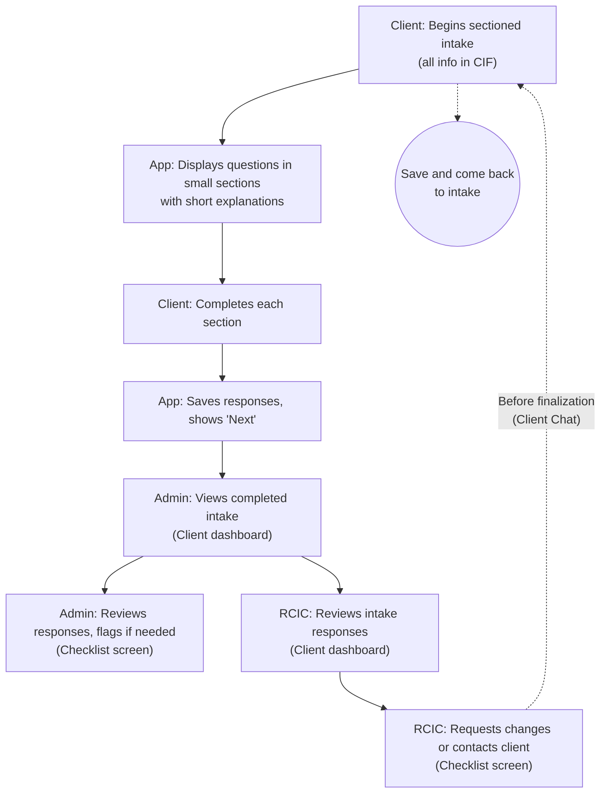
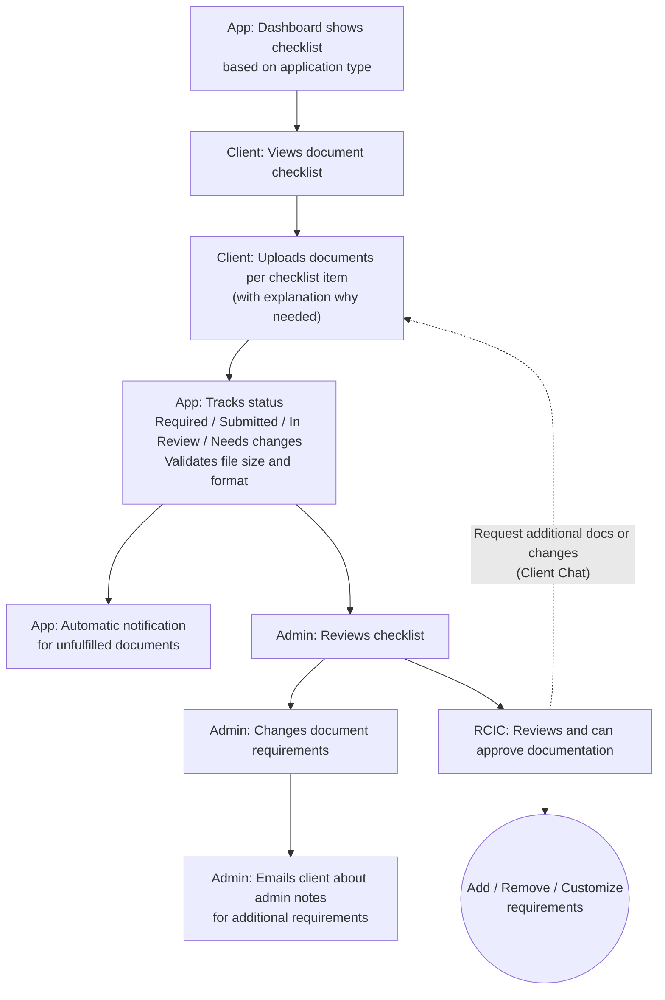
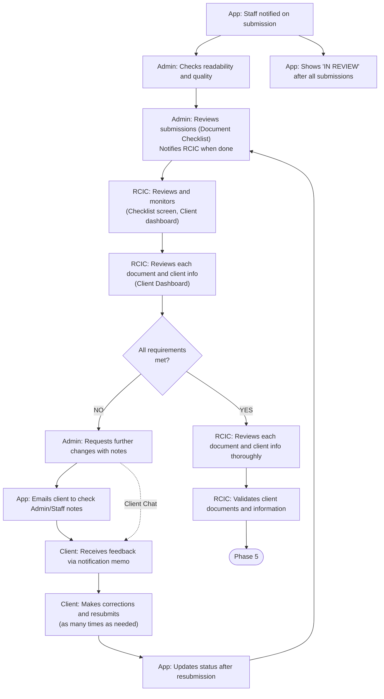
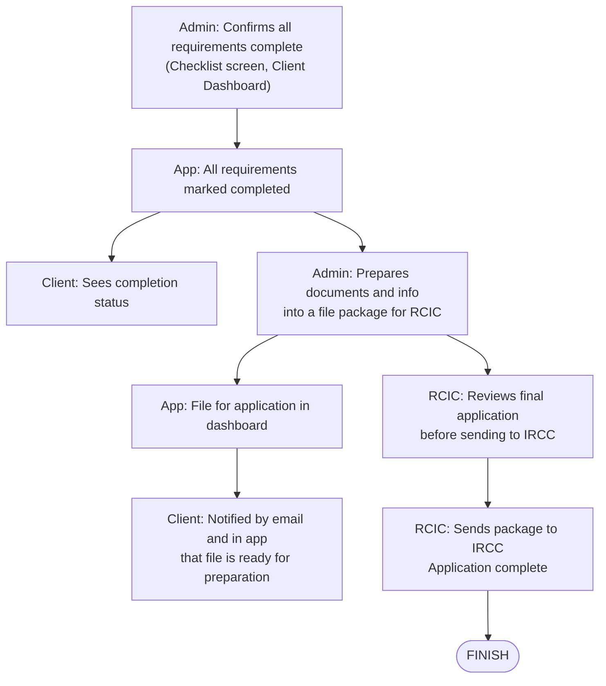

# FlowOui: Product User Flow (StayinCanada Immigration)

Source: Figma "FLOWOUI -- PRODUCT USERFLOW -- STAYINCANADA IMMIGRATION"

## Context and Notes

- The user flow **begins at client onboarding (after the invoice is paid)** and **ends at the RCIC application review and submission to IRCC** under the client's profile.
- Each phase is based on the MVP features and the essential workflow of the app, with the specified screens and additional features (in blue).
- The flow follows one general application process; some steps and requirements vary by application type.
- The pink "App" lane gives context for what actually happens inside the app.
- The flow is split by role to clarify actions within the same immigration process (5 phases): **Client → App → Admin/Staff → RCIC**. The app sits between staff and client, as it will in real life. The RCIC sits to the right of Admin/Staff to provide oversight and final validation before submission to IRCC.

**Open notes**

- IRCC application packaging and preparation need further clarification.
- Need to confirm features such as uploading pictures and file formatting.

## Legend

| Item           | Meaning                               |
| -------------- | ------------------------------------- |
| Pale yellow    | Client                                |
| Pale blue      | Admin                                 |
| Pale green     | Consultant / RCIC (Amr and Jean)      |
| Pink           | What happens in the app               |
| Violet diamond | Decision                              |
| Red arrow      | NO                                    |
| Green arrow    | YES                                   |
| Dashed arrow   | Corrections                           |
| Black arrow    | Regular process / next step           |
| Blue arrow     | Optional step                         |
| Blue circle    | Additional feature                    |
| (Brackets)     | Specifies which screen                |
| `**`           | Important                             |
| Star           | Needs attention / further development |
| Question mark  | Needs clarification / refining        |

**Screens:** 1. Log in / Sign up page · 2. Home Dashboard · 3. All Clients Dashboard (for Staff) · 4. Client Dashboard (for Staff) · 5. Intake screens · 6. Document Checklist screen · 7. Client Profile

## Overview

**Additional features spanning phases:** Progress bar (Phases 2-5) · Client Chat (Phases 2, 3, 4)

---

## Phase 1: Onboarding

| Role       | Steps                                                                                                                                                                                                                             |
| ---------- | --------------------------------------------------------------------------------------------------------------------------------------------------------------------------------------------------------------------------------- |
| **Client** | Receives an invitation link (via email) from StayinCanada · Signs up for an account and logs in                                                                                                                                   |
| **App**    | Link directs user to the app · Creates client account, and creates dashboard and workspace                                                                                                                                        |
| **Admin**  | Logs in through Admin Portal · Copies link and sends it to client after receiving information from RCIC · Assigns application type to user                                                                                        |
| **RCIC**   | **START:** Client is confirmed after consultation · Logs in through RCIC / Staff portal · Selects client, reviews client profile _(All Clients Dashboard screen)_ · Confirms application and case type `**` based on consultation |

---

## Phase 2: Client Intake

| Role       | Steps                                                                                                                                                                                                 |
| ---------- | ----------------------------------------------------------------------------------------------------------------------------------------------------------------------------------------------------- |
| **Client** | Begins the sectioned intake questions (includes all info in the CIF) · Completes after each section of the intake is done · _Additional feature:_ user can save and come back to the intake questions |
| **App**    | Displays questions in smaller sections at a time (provides short explanations) · Saves responses and displays "next" when users complete a section                                                    |
| **Admin**  | Views when a user has completed their intake _(Client dashboard)_ · Can review users' responses and flag if necessary _(Checklist screen)_                                                            |
| **RCIC**   | Can review intake responses and information _(Client dashboard)_ · Upon review, can request changes or contact client for more info _(Checklist screen)_                                              |

**Before finalization, can request changes or more info** (dashed correction loop back to the client, via _Client Chat_).

---

## Phase 3: Documentation Collection

| Role       | Steps                                                                                                                                                                                                                                            |
| ---------- | ------------------------------------------------------------------------------------------------------------------------------------------------------------------------------------------------------------------------------------------------ |
| **Client** | Can view document checklist based on application · Uploads required documents by clicking each checklist item (with an explanation of why it's needed)                                                                                           |
| **App**    | Dashboard displays document checklist based on application type · Tracks uploads and submissions; status = **Required, Submitted, In Review, Needs changes** · Validates file size and format · Automatic notification for unfulfilled documents |
| **Admin**  | Can review checklist _(Checklist screen)_ · Can change document requirements for client _(Checklist screen)_ · Sends email notification of admin notes on web app to client for additional requirements                                          |
| **RCIC**   | Reviews and can approve documentation _(Checklist screen)_ · _Additional feature:_ Add / Remove / Customize requirements                                                                                                                         |

**Can request additional documents or changes to existing ones** (dashed correction loop back to the client, via _Client Chat_).

---

## Phase 4: Feedback and Validation Process

| Role       | Steps                                                                                                                                                                                                                                                                                                   |
| ---------- | ------------------------------------------------------------------------------------------------------------------------------------------------------------------------------------------------------------------------------------------------------------------------------------------------------- |
| **Client** | Receives admin feedback through notification memo · Makes any further corrections and resubmissions (**re-submits as many times as needed**)                                                                                                                                                            |
| **App**    | Once submitted, staff is notified · After all submissions, displays "IN REVIEW" · Updates status after resubmission · Sends email notification to client to check Admin/Staff notes                                                                                                                     |
| **Admin**  | Checks readability and quality · Reviews document submissions _(Document Checklist)_; once review is done, notifies RCIC · Requests further changes to client with notes                                                                                                                                |
| **RCIC**   | Can review and monitor _(Checklist screen, Client dashboard)_ · Can review each document and client information _(Client Dashboard)_ · **Decision: All requirements met?** · YES: reviews each document and client info thoroughly _(Client Dashboard)_, then validates client document and information |

**Decision logic:** NO → Admin requests further changes with notes → client corrects and resubmits → back to review. YES → RCIC validates → Phase 5.

---

## Phase 5: Application Preparation

| Role       | Steps                                                                                                                                                | 
| ---------- | ---------------------------------------------------------------------------------------------------------------------------------------------------- |
| **Client** | Can see completion status after all requirements are met · Is notified on email and in the app that their file is ready for application preparation  |
| **App**    | All requirements are marked as completed · File for application appears in dashboard                                                                 |
| **Admin**  | Confirms whether all requirements are complete _(Checklist screen, Client Dashboard)_ · Prepares all documents and info into a file package for RCIC |
| **RCIC**   | Reviews final application before sending off to IRCC · Sends package to IRCC and application is complete. **FINISH**                                 |

---

## Additional Features (blue circles)

| Feature                                    | Where it appears                  |
| ------------------------------------------ | ---------------------------------- |
| Save and come back to the intake questions | Phase 2 (Client)                  |
| Client Chat                                | Phases 2, 3, 4 (correction loops) |
| Add / Remove / Customize requirements      | Phase 3 (RCIC)                    |
| Progress bar                               | Spans Phases 2-5                  |
